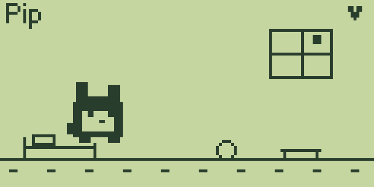
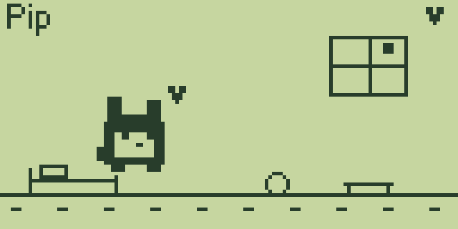
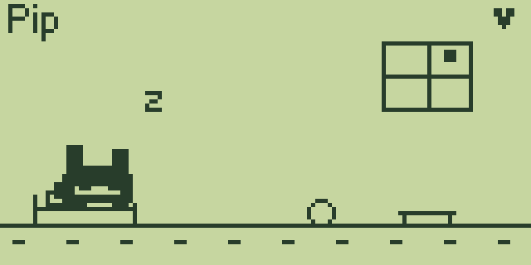
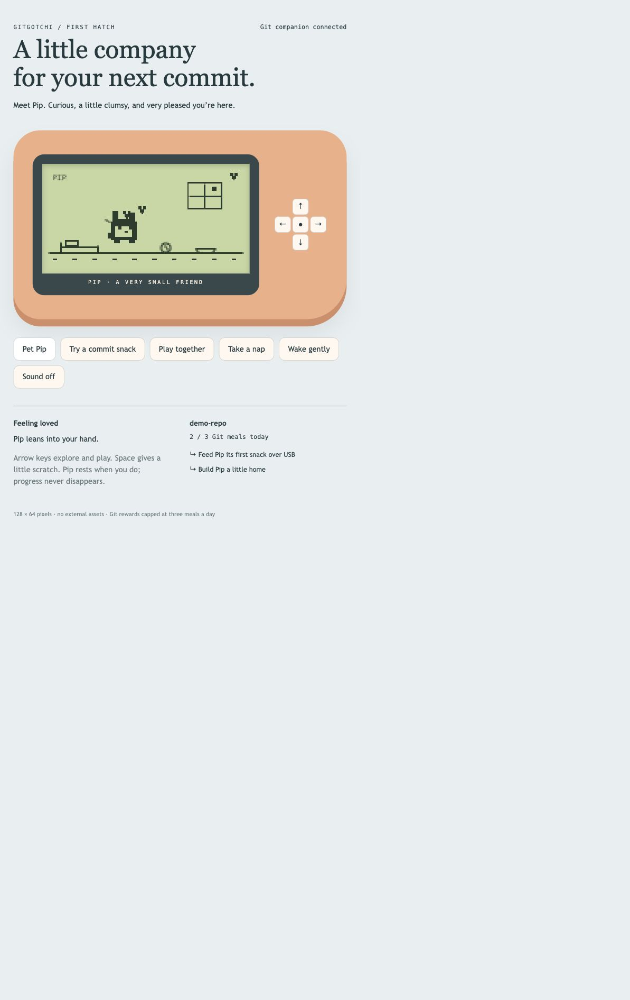

# Gitgotchi

**A tiny pet that lives on your Flipper Zero and gets a snack when you make progress in Git.**

Meet **Pip**: a curious pixel creature with a bed, a ball, a food bowl, and a small window onto the world. Pip wanders, blinks, breathes, naps, eats, and enjoys a little affection while you work.

Gitgotchi is an early, working prototype with a native Flipper app, a Python Git companion, and an interactive browser preview. No ESP32, cloud service, GitHub token, or AI model is needed to run it.

## See Pip

These are **real framebuffer captures from a physical Flipper Zero**, enlarged 6× with a green LCD palette. They are screen captures, not photographs of the device.

| Awake and exploring | Getting a little affection | Having a nap |
| --- | --- | --- |
|  |  |  |

The companion also includes a separate, interactive Mac/browser prototype:



The browser pet and the Flipper pet have separate saves. The browser artwork and animation are richer; the browser is not a live mirror or remote control of the device.

## What works today

- Native 128 × 64 Flipper habitat with procedural pixel artwork.
- Breathing, blinking, wandering, petting hearts, eating, sleeping, and simple play animations.
- Physical button interactions, including waking Pip by moving left or right.
- Affection and lifetime meal totals saved to the Flipper SD card on normal app exit.
- Local Git polling with one snack per eligible observed change and a three-meal daily cap per repository.
- USB CLI delivery with an acknowledgement containing the device's meal, affection, and mood values.
- A localhost browser preview with demo controls, optional sound, activity history, and local persistence.
- A utility for capturing actual Flipper framebuffer screenshots.

Pip never dies, and taking a break does not erase your progress. The pet keeps animating on-device while unplugged, as long as the app is open. Closing the app pauses the pet; it does not run as a background firmware service.

## Quick start: try the browser pet

Requirements: Python 3.11+, Git, and a browser. The preview requires only Python's standard library.

```sh
git clone https://github.com/thegreatLUCY/gitgotchi.git
cd gitgotchi
python3 companion/app.py --repo .
```

Open **http://127.0.0.1:8765**. The initial Git history establishes a baseline. Make a new file-changing commit after the watcher starts to trigger a snack.

To watch a different project:

```sh
python3 companion/app.py --repo /absolute/path/to/your/project
```

Your project needs an existing commit before it can earn food. An empty repository can be watched, but the companion waits for its first commit and uses that commit as its baseline. Stop the server with **Ctrl+C**.

For an offline animation-only preview, open [`companion/index.html`](companion/index.html) directly. Git activity requires the Python server.

### Preview controls

| Control | Action |
| --- | --- |
| Pet Pip / Space | Affection and a little heart |
| Try a commit snack | Preview an eating interaction; does not earn a Git reward |
| Up / Take a nap | Walk to bed and sleep |
| Down / Play together | Play with the ball |
| Left / Right | Wander across the room and wake up |
| Wake gently | Return to the middle of the habitat |
| Sound off/on | Toggle browser-only sound |

## Install Pip on Flipper Zero

You need a Flipper Zero with an SD card and a USB **data** cable. No extra board is required.

### Choose a compatible app build

| File | SDK / API | Verification |
| --- | --- | --- |
| [`gitgotchi-xfw0053-api54.fap`](firmware/gitgotchi-xfw0053-api54.fap) | Xtreme XFW-0053 / 54.0 | Installed and tested on a physical device |
| [`gitgotchi-official151-api88.fap`](firmware/gitgotchi-official151-api88.fap) | Official 1.5.1 / 88.2 | Compiled and checked by uFBT; not hardware-tested |

These are application files, not firmware updates. Match your installed firmware's API. If Flipper reports an API mismatch, rebuild with the appropriate SDK rather than installing different firmware just to run Pip.

1. Connect to **qFlipper** and open its file manager.
2. Copy the matching `.fap` into **SD Card → apps → Games**. You can name the file `gitgotchi.fap`.
3. On Flipper, open **Apps → Games → Gitgotchi**.
4. Close qFlipper before starting the USB companion, so only one program owns the serial connection.

### Physical controls

| Button | Action |
| --- | --- |
| OK | Pet Pip |
| Up | Walk to bed and sleep |
| Down | Play |
| Left / Right | Walk and wake up |
| Back | Save affection/meals and exit |

Save by exiting normally before powering off. Abrupt power loss can lose activity since the last app exit.

## Connect Git to the physical pet

Create a Python environment and install the USB serial dependency:

```sh
python3 -m venv .venv
source .venv/bin/activate
python -m pip install -r requirements.txt
```

List serial ports:

```sh
python -m serial.tools.list_ports
```

On macOS the Flipper usually appears as `/dev/cu.usbmodem...`; Linux commonly uses `/dev/ttyACM0`, and Windows uses a `COM` port. Substitute the actual port in this command:

```sh
python companion/app.py \
  --repo /absolute/path/to/your/project \
  --serial /dev/cu.usbmodemYOUR_FLIPPER
```

Keep Gitgotchi open on the device. The terminal should print `USB confirmed: status`, followed by the local preview address. Commit a file change; within a few seconds, the companion sends a snack and prints `USB confirmed: feed`.

If port 8765 is occupied, add `--port 8766`. Keep one companion process per state file and serial device. Use `--state /path/to/pip-state.json` for an independent watcher session.

Gitgotchi watches the **local checkout**. It does not need a GitHub account connection and does not fetch remote activity, pull requests, or contributions from other machines.

## How Git becomes food

The watcher polls HEAD every two seconds:

1. The first observed commit becomes the baseline; existing history earns no food.
2. A new HEAD must descend from the previous HEAD.
3. The two commits must have a net file difference.
4. An eligible observation awards one meal, up to three per repository per local calendar day.
5. The watcher records the new HEAD so restarts do not feed the same commit again.

Several commits between polls count as one meal. Empty commits, backward resets, and divergent history movement do not earn food. A checkout to a descendant commit can count. This is a simple activity heuristic, not a measure of code quality. Rewriting history can bypass its intent; it is a personal motivator, not an anti-cheat system.

The daily cap belongs to the companion. Manually sending the `feed` command bypasses it. The Flipper stores a separate lifetime meal total.

## Architecture

```text
Your local Git repository
        │ read-only polling
        ▼
Python companion ─────── localhost HTTP ──────► Browser pet
        │
        │ USB serial CLI: gitgotchi feed
        ▼
Native Flipper app
        │
        ├── Local behavior and drawing loop
        ├── Buttons and interaction states
        └── SD card save on exit
```

The companion reads Git metadata and net file changes; it never commits, pushes, edits tracked files, or runs project code. It writes its own state file. The HTTP server binds only to `127.0.0.1` and serves the preview and a small state endpoint.

### State and protocol

- Watcher: `companion/state.json` by default, containing repository paths, HEAD baselines, daily reward counts, and up to 30 event labels/commit IDs. This file is ignored by Git.
- Browser: `localStorage`, under `pip-v1`, containing affection, demo meal count, and position.
- Flipper: `/ext/apps_data/gitgotchi/pip.dat`, containing a format marker, affection, and lifetime meal count.
- CLI: `gitgotchi status`, `feed`, `pet`, `sleep`, `wake`, and `screenshot`, available while the app is open.
- Status response: `PIP meals=1 bond=2 mood=0`.
- Mood values: idle `0`, walk `1`, pet `2`, eat `3`, sleep `4`, play `5`.

The device connection indicator reflects the last acknowledged command; it is not a continuous heartbeat. A recorded Git reward can be missed by an offline device: there is no persistent USB retry queue or automatic reconnection yet.

## Capture your own Flipper screenshots

Stop the companion and close qFlipper to release the USB port. With Gitgotchi open:

```sh
python tools/capture_flipper.py \
  --serial /dev/cu.usbmodemYOUR_FLIPPER \
  --action pet \
  --output pip-petting.png
```

Optional actions: `pet`, `feed`, `sleep`, and `wake`. `feed` changes the device's meal count. Use `--wait 4` to let Pip reach bed before a sleeping capture. Omit `--action` to capture the current screen without initiating an interaction.

The utility decodes the app's 128 × 64 framebuffer and writes an enlarged PNG using the Python standard library; only the serial connection needs pyserial. The bundled decoder uses the polarity observed on the tested firmware; another firmware/display configuration may require changing the `dark` expression in `write_png`.

## Build from source

Install the official [uFBT tool](https://github.com/flipperdevices/flipperzero-ufbt) in your environment:

```sh
python -m pip install ufbt
cd flipper
ufbt
```

uFBT downloads its SDK/toolchain on first use. The output is `flipper/dist/gitgotchi.fap`. The default SDK targets the current official release, which may differ from your device.

For the tested Xtreme release, use a separate SDK directory:

```sh
export UFBT_HOME="$PWD/.ufbt"
ufbt update --hw-target f7 --url \
  https://github.com/Flipper-XFW/Xtreme-Firmware/releases/download/XFW-0053_02022024/XFW-0053_02022024-sdk.zip
ufbt
```

The older compiler uses Rosetta on Apple Silicon. The C source selects the classic or current CLI API using the SDK headers. Compatible compilation does not guarantee identical behavior across all firmware forks.

## Development and verification

```sh
python3 -m unittest discover -s tests -v
python3 -m py_compile companion/app.py tools/capture_flipper.py
```

The watcher tests cover first-run baselines, repeated polling, restart deduplication, the daily cap, backward resets, and empty commits. The GitHub Actions workflow runs those tests and checks the inline JavaScript syntax.

Verified during development:

- Both listed firmware builds compile and pass uFBT's app compatibility check.
- The API 54 app uploads with a matching checksum and launches on a physical Flipper.
- A real local Git commit produces an acknowledged USB meal.
- The meal count survives exiting and reopening the app.
- Actual device frames can be captured for awake, petting, and sleeping states.
- The browser preview responds to interaction controls and real Git events.

## Troubleshooting

| Symptom | What to try |
| --- | --- |
| USB port busy | Close qFlipper, serial terminals, and other companion instances. |
| No USB acknowledgement | Open Gitgotchi first, confirm the serial port, then restart the companion. |
| API mismatch | Choose the matching build or compile against your firmware SDK. |
| No food after a commit | Check the baseline, daily cap, net file difference, and watched repository path. |
| Companion says repository is unreadable | Confirm `git -C /your/project rev-parse HEAD` succeeds. |
| Browser demo works but Flipper does nothing | Preview controls act locally; use a real eligible Git commit for the USB path. |
| Device save is missing | Confirm the SD card is mounted and exit with Back before powering off. |
| Browser shows companion offline | Run the Python server and open its printed localhost URL. |

## Roadmap

- [ ] Persistent personality, favorite objects, and more expressive animation.
- [ ] Hunger and energy progression with a forgiving vacation/hibernate mode.
- [ ] Evolution and habitat unlocks for meaningful project milestones.
- [ ] Rewards for tests, bug fixes, and code review.
- [ ] Reliable USB reconnect/replay and synchronized pet state.
- [ ] Optional local EmbeddingGemma retrieval and coding-agent quests.

AI, GitHub PR integration, evolution, and a complete needs simulation are **not implemented** in this version.

## Contributing

Small, focused improvements are welcome. Include the firmware/API you tested, a short description of the behavior, and a screenshot or clip for animation changes. Run the watcher tests before opening a pull request. Keep screenshots free of private repository information and keep local state files out of commits.

## License

MIT. See [LICENSE](LICENSE). Third-party dependencies and SDKs retain their own licenses.
